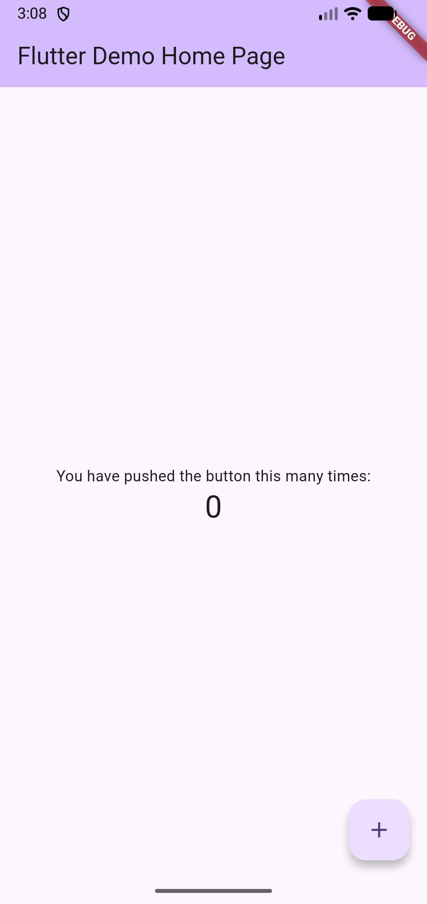

# Flutter Installation and Setup Assignment

## Project Name
demo_app

## Project Description
This project demonstrates the creation and successful execution of a Flutter application using Android Studio and the Flutter SDK.

## Application Running on Android Emulator

The following screenshot shows the Flutter application running successfully on an Android emulator.



## Technologies Used
- Flutter SDK
- Dart Programming Language
- Android Studio
- Android Emulator

## Commands Used

```bash
flutter doctor
flutter create demo_app
flutter run
```
